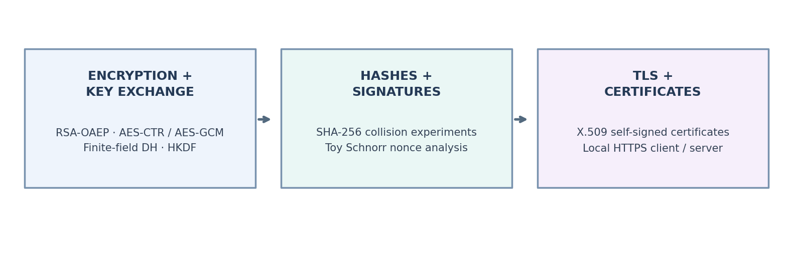
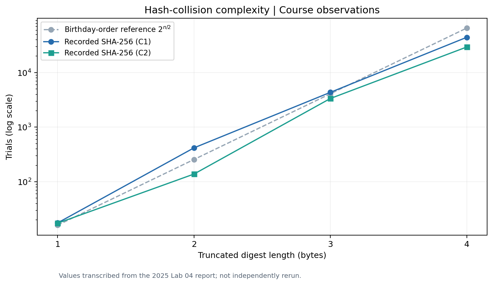

<div align="center">

# Applied Cryptography & Security

**Encryption · Key Exchange · Hash Functions · Digital Signatures · TLS**

*Python experiments exploring cryptographic algorithms, their security properties, and certificate-based secure communication.*

</div>



## Overview

This repository brings together coursework experiments from **Applied Information Security and Cryptography (2025)** and additional, runnable Python demonstrations. It explores how encryption, key agreement, hashing, digital signatures, and X.509 certificates work, as well as how implementation choices affect security.

The project includes original course Python scripts for reference and a separate, tested collection of companion examples using current Python cryptography APIs.

## Experiments

| Area | Concepts explored | Run |
|---|---|---|
| **Symmetric encryption** | AES-CTR, authenticated AES-GCM, fresh nonces | `python -m demos.encryption_and_key_exchange` |
| **Public-key cryptography** | RSA-OAEP encryption and RSA-PSS signatures | Same demo |
| **Key exchange** | Finite-field Diffie–Hellman (FFDHE2048), HKDF, shared session keys | Same demo |
| **Hash functions** | SHA-256, truncated-digest collisions, birthday-bound behavior | `python -m demos.hashes_and_signatures` |
| **Signature security** | Mathematical illustration of consecutive-nonce weakness in a toy Schnorr scheme | Same demo |
| **TLS and certificates** | RSA/ECDSA certificate generation, local HTTPS, X.509 inspection, verified TLS connection | See below |

### Hash collision experiment



This figure summarizes course experiments on **truncated SHA-256 digests** (1–4 bytes). The full 256-bit SHA-256 digest is not being broken: shortening the output intentionally makes collision searches feasible in a classroom setting. The plotted measurements are drawn from the original lab report and have not been independently rerun for this package.

## Run the project

**Requirements:** Python 3.10+ and the `cryptography` package. `matplotlib` is only needed to regenerate documentation plots.

```bash
python -m venv .venv
# Windows: .venv\Scripts\activate
# macOS/Linux: source .venv/bin/activate
pip install -r requirements-core.txt
```

Run the encryption and key-exchange demos:

```bash
python -m demos.encryption_and_key_exchange
python -m demos.hashes_and_signatures
```

### Local TLS demo

Generate a **new self-signed certificate**, then launch a local HTTPS server:

```bash
python -m demos.generate_certificate ECDSA
python -m demos.tls_server
```

In a **second terminal**, from the same project directory:

```bash
python -m demos.tls_client
```

The client checks the locally generated certificate against `localhost`, negotiates TLS 1.2 or later, and prints the X.509 subject, TLS protocol, cipher suite, and HTTP response. Private keys are written to `.local/`, which is excluded by `.gitignore`. This example uses the Python standard library rather than Flask.

To generate an RSA certificate instead, stop the server and run `python -m demos.generate_certificate RSA` before restarting it.

## Implementation and organization

```text
Applied_Cryptography_Security/
├── crypto_lab/                    # Reusable educational algorithms and helpers
│   ├── symmetric.py               # AES-CTR / AES-GCM
│   ├── public_key.py              # RSA and finite-field DH
│   ├── hashing.py                 # SHA-256 and truncated-collision search
│   ├── toy_schnorr.py             # Related-nonce demonstration
│   └── certificates.py            # Local X.509 certificate generation
├── demos/                         # Runnable commands (python -m demos...)
├── coursework_original/           # Original Lab 03/04/05 Python files
├── tests/                         # Automated correctness and behavior checks
├── docs/
│   ├── images/                    # Diagrams and experiment plot
│   ├── COURSEWORK.md              # Source-to-demo mapping
│   └── SECURITY.md                # Scope and key-handling notes
├── scripts/create_figures.py      # Regenerate documentation images
├── requirements-core.txt
└── README.md
```

### Validation

```bash
python -m unittest discover -s tests -v
```

Tests cover encryption/decryption, AES-GCM integrity, RSA signatures, Diffie–Hellman key agreement, truncated-digest collisions, Schnorr nonce relationships, and certificate generation. The local TLS client/server can be exercised with the commands above.

## Academic context

**Course:** Applied Information Security and Cryptography · Politecnico di Torino · 2025  
**Student:** Tala Hareb

The course covered classical cryptanalysis (monoalphabetic and Vigenère ciphers), simplified AES and avalanche effects, RSA/Diffie–Hellman, hash functions and signatures, and TLS/X.509. The packaged source code focuses on **Labs 03–05**; Labs 01–02 are represented in the course context rather than new implementations.
